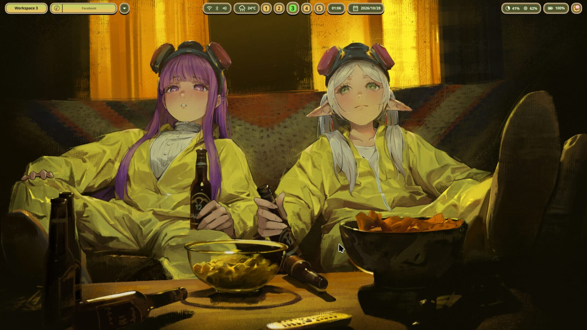
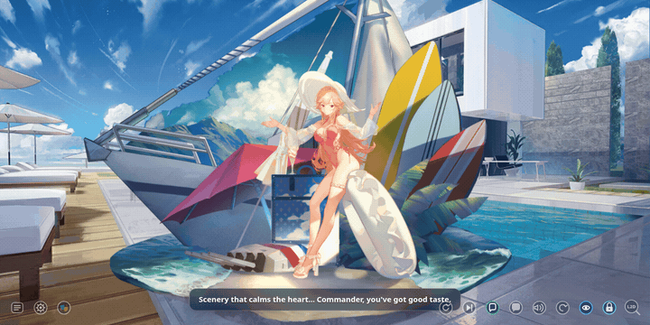
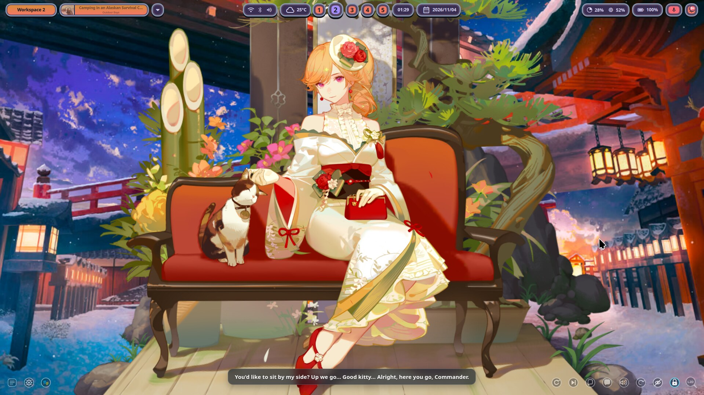
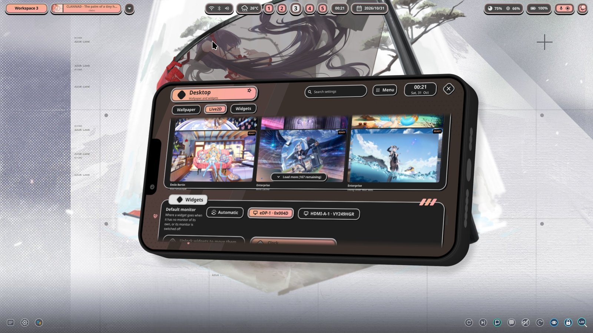
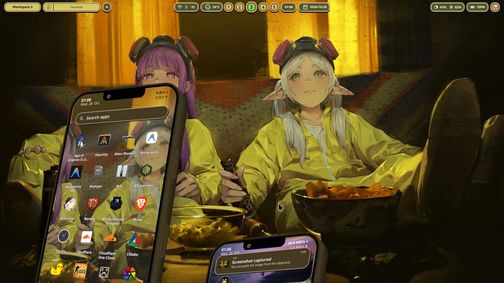
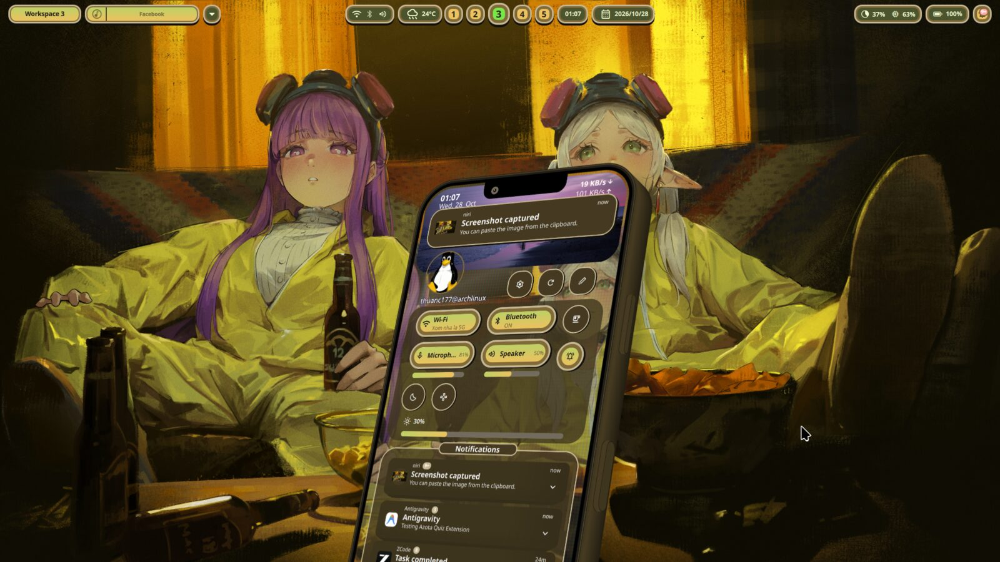
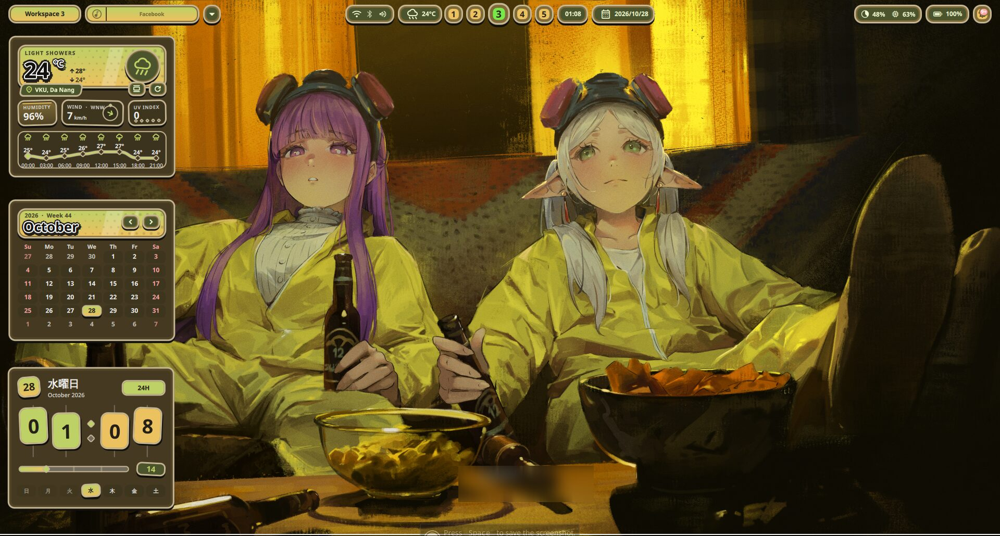
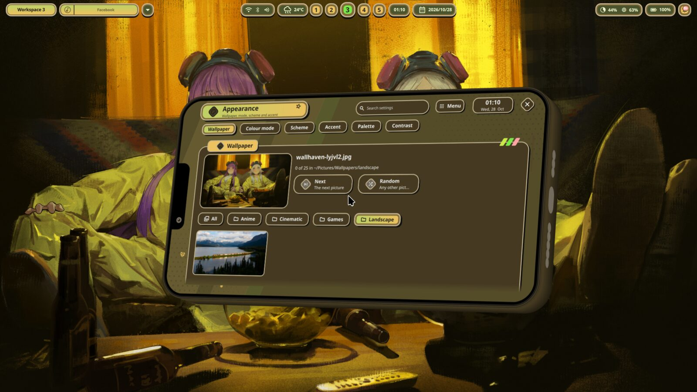

<div align="center">

# 🌊 Mizumi Dotfiles

**A modern, scrollable-tiling Wayland rice for Arch Linux driven by [niri](https://github.com/YaLTeR/niri)**  
Featuring a dual-shell architecture (**Mizu** via Quickshell & **Noctalia** fallback) living **side-by-side with KDE Plasma** with absolute zero configuration leakage.

[](https://archlinux.org)
[](https://github.com/YaLTeR/niri)
[](https://quickshell.outfoxxed.me)
[](https://github.com/noctalia-dev/noctalia)
[](https://kde.org/plasma-desktop/)
[](https://github.com/fcitx/fcitx5)
[](SPECIFICATION.md)

[**📖 Full Specification & Architecture**](SPECIFICATION.md) · [**🇻🇳 Hướng Dẫn Sử Dụng (Usage)**](docs/USAGE.md) · [**⚡ Performance Telemetry**](docs/PERFORMANCE.md)

</div>

---

## 🍱 Two Rices, One Codebase

| Variant | Branch | Description |
|---|---|---|
| **Mizu Lite** | [`main`](https://github.com/AtelierMizumi/dotfiles) | Clean, minimal rice — static image wallpaper with dynamic Material You palette. |
| **Mizu Full** | [`feat/mizu-l2d`](https://github.com/AtelierMizumi/dotfiles/tree/feat/mizu-l2d) | Everything in Lite + interactive [mizu-l2d](https://github.com/AtelierMizumi/mizu-l2d) wallpaper daemon, model browser, and live character theming. |

---

## 📸 Visual Showcase

<div align="center">

### Desktop & Dynamic Theming
*Every colour is automatically extracted from the wallpaper or active Live2D character.*



### 🎬 Live2D Motion & Interaction Preview


*(Interactive model demo with gaze follow & physics. HD Video: [model-preview.mp4](docs/screenshots/model-preview.mp4))*

</div>

<div align="center">

| | |
|:---:|:---:|
|  |  |
| **Interactive Live2D Background**<br/>Cubism Core on `wlr-layer-shell` with pointer follow | **Dynamic Palette Extraction**<br/>Tokens and niri focus rings generated from model textures |
|  |  |
| **3D Perspective Phone Launcher**<br/>Smooth physics-based app grid rising from screen edge | **Quick Settings Panel**<br/>Wi-Fi, Bluetooth, Audio, Per-Monitor Brightness & Live2D tile |
|  |  |
| **Desktop Widgets**<br/>Da Nang weather, calendar, clock, and player card | **Settings & Model Picker**<br/>Folder chips, paginated thumbnails, and placement controls |

</div>

---

## ✨ Highlights

- 🧩 **Dual-Shell System:** Fluid [Quickshell](https://quickshell.outfoxxed.me/) desktop environment with [Noctalia](https://github.com/noctalia-dev/noctalia) as instant fallback. Hot-switchable via `scripts/switch-shell.sh`.
- 🛡️ **KDE Plasma Zero-Leakage:** Strictly isolated environment variables, portals (`niri-portals.conf`), and MIME defaults (`niri-mimeapps.list`). Guaranteed byte-identical Plasma configs verified by `scripts/check-plasma-intact.sh`.
- 🎨 **Adaptive Material-3 Theming:** `mizu_palette.py` & `l2d_palette.py` extract palette tokens and inject them into `~/.cache/mizu/tokens.json` and `~/.config/niri/colors.kdl` live.
- 🖥️ **Integer Scaling & Hybrid Graphics:** 1.0 integer scaling on 144Hz & 120Hz displays. Compositor runs on low-power Intel iGPU (`renderD129`); compute/gaming offloads to NVIDIA dGPU via `prime-run`.
- ⌨️ **Multilingual Typing:** Fcitx5 cyclic toggle between English (US) ➔ Vietnamese (Lotus) ➔ Japanese (Anthy).

---

## ⌨️ Essential Keybindings

| Key | Action |
|---|---|
| <kbd>Mod</kbd> + <kbd>Return</kbd> / <kbd>Mod</kbd> + <kbd>T</kbd> | Launch Terminal (**Ghostty**) |
| <kbd>Mod</kbd> + <kbd>B</kbd> | Launch Web Browser (**Zen Browser**) |
| <kbd>Mod</kbd> + <kbd>E</kbd> | Launch File Manager (**Nautilus**) |
| <kbd>Mod</kbd> + <kbd>D</kbd> | Toggle App Launcher |
| <kbd>Mod</kbd> + <kbd>S</kbd> | Toggle Quick Settings Center |
| <kbd>Mod</kbd> + <kbd>Alt</kbd> + <kbd>S</kbd> | Toggle Desktop Settings & Wallpaper Picker |
| <kbd>Mod</kbd> + <kbd>BackSpace</kbd> | Cycle Input Method (US ➔ VN ➔ JP) |
| <kbd>Mod</kbd> + <kbd>Shift</kbd> + <kbd>S</kbd> | Interactive Area Screenshot |
| <kbd>Mod</kbd> + <kbd>H</kbd> / <kbd>J</kbd> / <kbd>K</kbd> / <kbd>L</kbd> | Navigate Column Focus (Left / Down / Up / Right) |
| <kbd>Mod</kbd> + <kbd>Shift</kbd> + <kbd>H</kbd> / <kbd>J</kbd> / <kbd>K</kbd> / <kbd>L</kbd> | Move Column Position |

*(Full keybinding reference is available in [docs/USAGE.md](docs/USAGE.md).)*

---

## 🚀 Quickstart & Controls

### Live Shell Switcher
```sh
# Switch between Quickshell (mizu) and Noctalia
scripts/switch-shell.sh mizu        # Activate Mizu shell
scripts/switch-shell.sh noctalia    # Activate Noctalia fallback
scripts/switch-shell.sh toggle      # Toggle between them
scripts/switch-shell.sh status      # Inspect active shell state
```

### Verification & Testing
```sh
# Verify absolute KDE Plasma isolation integrity
bash scripts/check-plasma-intact.sh compare

# Execute full automated test suite
bash tests/run-all.sh
```

---

## 📚 Technical Specifications

For full architectural blueprints, component contracts, portal routing details, and design specifications, see:

👉 **[Complete System Specification (`SPECIFICATION.md`)](SPECIFICATION.md)**

---

<details>
<summary><b>🛠️ Install Runbook & TTY Deployment Guide (Click to expand)</b></summary>

### Why `niri-portals.conf` exists
The user-level `~/.config/xdg-desktop-portal/portals.conf` normally routes interfaces to Plasma portals. A desktop-specific `niri-portals.conf` in the same directory takes precedence under `XDG_CURRENT_DESKTOP=niri`, ensuring niri receives `xdg-desktop-portal-gnome` which **ScreenCast** (Discord screen sharing) requires, while Plasma continues using `kde-portals.conf`.

### Verification commands
Run `scripts/check-plasma-intact.sh <command>` (Exit code: `0` = OK, `1` = violation, `2` = usage error):
- `snapshot` / `compare`: Hashes `kdeglobals`, `kdedefaults/kdeglobals`, `mimeapps.list`, `gtk-3.0/settings.ini`, `gtk-4.0/settings.ini`, `xdg-desktop-portal-kderc`, `xdg-desktop-portal/portals.conf`, `xdg-desktop-portal/kde-portals.conf`, and gsettings `color-scheme` / `gtk-theme`. **Refuses to run while `plasmashell` is running** to prevent false positives.
- `packages`: Validates that `xdg-desktop-portal-kde`, `plasma-desktop`, and `sddm` remain fully installed with zero missing files.
- `noctalia`: Verifies live and repo configurations. All built-in and community templates must be disabled, and `sync_color_scheme` must be false.

### Install runbook (driven from a TTY)

Every phase ends on a gate that must pass before the next one. Lines starting with `sudo` are yours to run, in a
**second VT** (for example Ctrl+Alt+F4), not through the Claude Code prompt: the password prompt and the sandbox make
`sudo` unreliable there. Read pacman's prompt and **abort** if it removes or replaces any `plasma-*`, `kde-*` or
`xdg-desktop-portal-kde` package.

#### Before you leave Plasma
1. **Merge.** In `~/Projects/Tools/dotfiles`: `git merge --ff-only worktree-niri-noctalia-spec`.
2. **Check free space.** `df -h /`.
3. **Test the console font.** On a TTY run `printf 'Tiếng Việt: ơ ư ạ ế\n'`.
4. **Start session in main checkout** (`cd ~/Projects/Tools/dotfiles && claude`).

#### Phases
**You must keep plasmashell stopped from the snapshot to the final compare.** Plasma rewrites some checked files itself,
so a Plasma login in between makes `compare` report false positives you cannot tell from real changes.

1. **Leave Plasma and snapshot.**
   From a TTY run `loginctl terminate-session <id>`. Press Ctrl+Alt+F3, log in, run `scripts/check-plasma-intact.sh snapshot`.
2. **Smoke test the compositor with the untouched config.**
   This smoke test separates compositor and hybrid-GPU problems from shell problems. Pick the Niri session from SDDM greeter. Read which render node niri chose: `journalctl --user -u niri -b | rg -i 'render|device|drm'`. Log out of niri, return to TTY (Ctrl+Alt+F3), and run `scripts/check-plasma-intact.sh compare` (exit 0).
3. **Packages.**
   If sync database is stale, run `sudo pacman -Syu` (never `pacman -Sy` alone). Then:
   `sudo pacman -S stow noctalia xwayland-satellite xdg-desktop-portal-gnome`, followed by `scripts/check-plasma-intact.sh packages`.
4. **Stow both packages, then gate.**
   ```sh
   mv ~/.config/niri/config.kdl ~/.config/niri/config.kdl.bak.$(date +%F)
   stow -n -v --no-folding -t ~ niri noctalia    # dry run, expect no conflicts
   stow --no-folding -t ~ niri noctalia
   ```
   Run `scripts/check-plasma-intact.sh noctalia` before logging into niri again. Run `noctalia config validate` with **no argument**. Pass = exit 0 and no line starting with `WARN` or `ERROR`.
5. **Log into niri with the full config.**
   Confirm colors follow wallpaper and screen share works. Log out, return to TTY, and run `scripts/check-plasma-intact.sh compare` and `scripts/check-plasma-intact.sh noctalia`.
6. **Plasma last.**
   Only then log into Plasma and confirm it behaves normally, and that file dialogs are still the KDE ones.

#### Rollback
```sh
stow -D --no-folding -t ~ noctalia niri
rm -r ~/.local/state/noctalia ~/.cache/noctalia
mv ~/.config/niri/config.kdl.bak.<date> ~/.config/niri/config.kdl
```

#### Gaming & Discrete GPU
1. Use discrete GPU through `prime-run` (e.g. `prime-run mangohud %command%`).
2. Log with MangoHud (`Shift_L+F2`).
</details>
