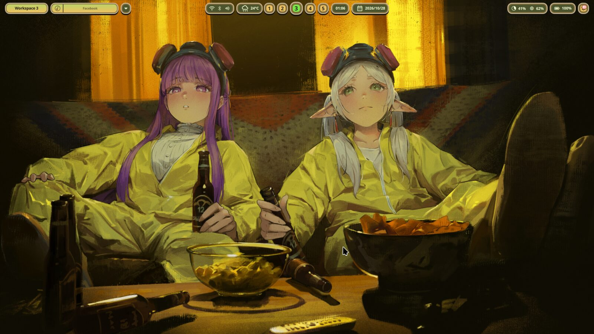
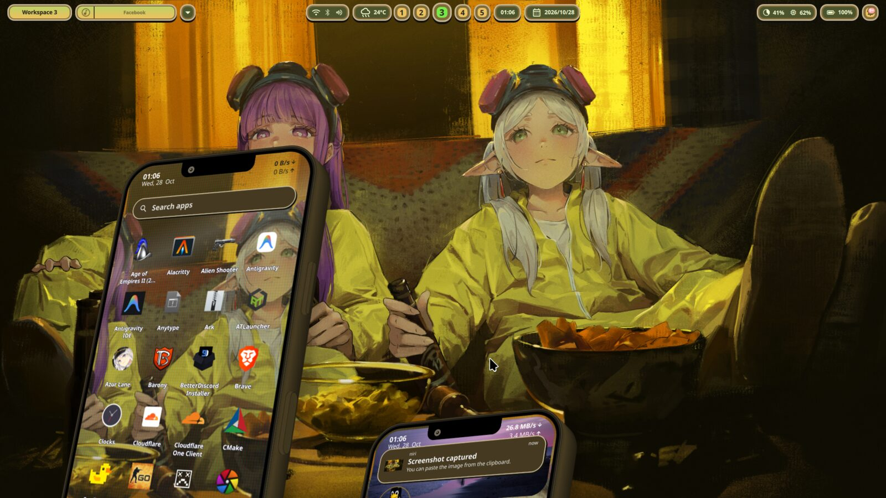
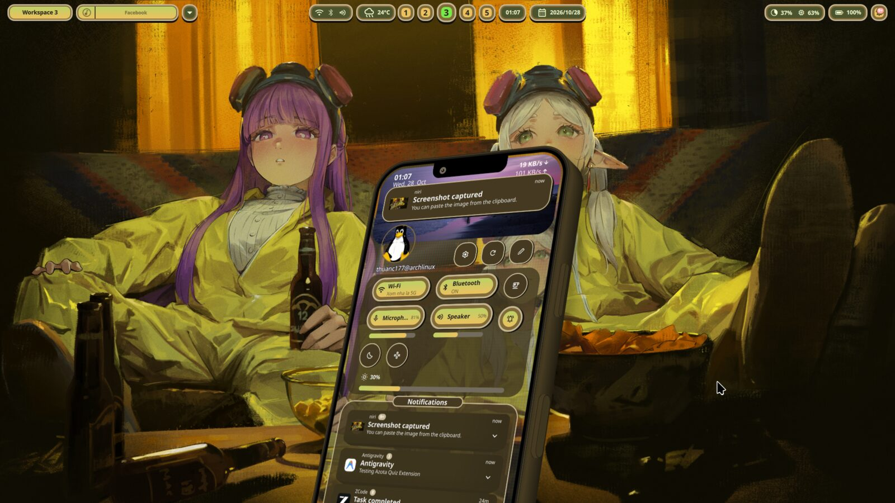
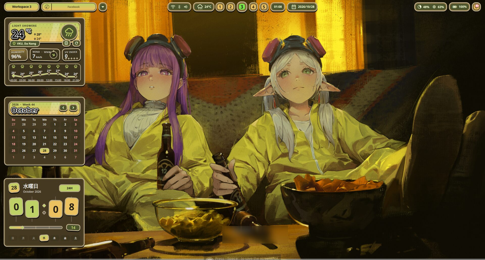
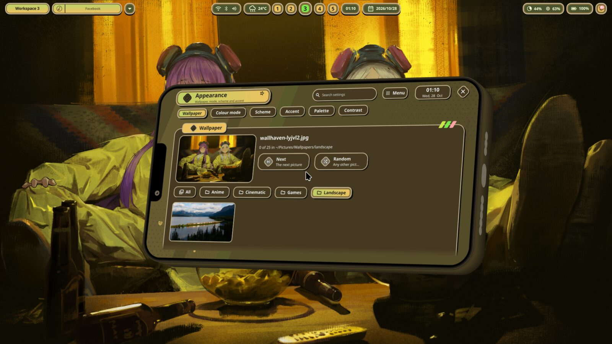
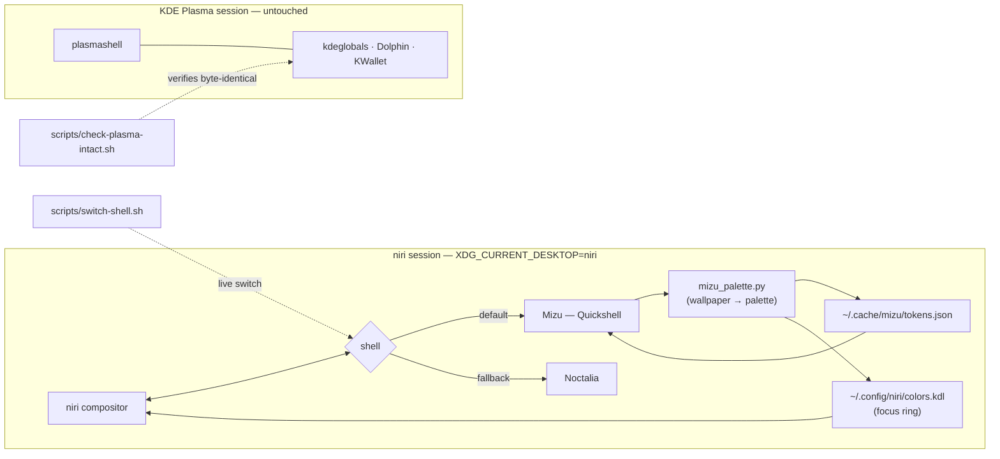

<div align="center">

# 🌊 Mizumi Dotfiles

**A personal Arch Linux rice** — a modern scrollable-tiling Wayland session driven by
[niri](https://github.com/YaLTeR/niri), featuring a dual-shell architecture
(**Mizu** via [Quickshell](https://quickshell.outfoxxed.me/) & **Noctalia** as minimal
fallback) living **side-by-side with KDE Plasma** without touching or modifying Plasma's
configuration files.

[](https://archlinux.org)
[](https://github.com/YaLTeR/niri)
[](https://quickshell.outfoxxed.me)
[](https://github.com/noctalia-dev/noctalia)
[](https://kde.org/plasma-desktop/)
[](https://github.com/fcitx/fcitx5)

</div>

> **Status:** Configs, shells, IPC handlers, tests, and Plasma integrity checks are fully implemented and verified.

Design Specs: [`docs/superpowers/specs/2026-10-24-niri-noctalia-rice-design.md`](docs/superpowers/specs/2026-10-24-niri-noctalia-rice-design.md) · Implementation Plan: [`docs/superpowers/plans/2026-10-24-niri-noctalia-rice.md`](docs/superpowers/plans/2026-10-24-niri-noctalia-rice.md) · User Guide: [`docs/USAGE.md`](docs/USAGE.md)

---

## 🍚 Two rices, one codebase

| Variant | Branch | What's different |
| --- | --- | --- |
| **Mizu Lite** | [`main`](https://github.com/AtelierMizumi/dotfiles) | The rice as described in this README — zero Live2D code. |
| **Mizu Full** | [`feat/mizu-l2d`](https://github.com/AtelierMizumi/dotfiles/tree/feat/mizu-l2d) | Everything in Lite, plus the interactive [mizu-l2d](https://github.com/AtelierMizumi/mizu-l2d) wallpaper: a Live2D character on the background layer, theme colors extracted from the model, independent/mirror multi-screen layout, a Quick Panel tile, and the model browser with on-demand download. |

Live2D is off by default in Full (`wallpaper.live = false`) and off means **zero**
Live2D processes, so Full degrades gracefully to Lite behaviour. Pick a branch —
the rest of the rice is identical.

---

## 🖼️ The Rice

<div align="center">

**Desktop** — wallpaper, bar and the palette generated from the picture



</div>

<div align="center">

| | |
|:---:|:---:|
|  |  |
| **Phone launcher** — a 3D perspective app grid that rises from the bottom edge | **Quick panel** — Wi-Fi, Bluetooth, audio, brightness, notifications |
|  |  |
| **Desktop widgets** — weather (Da Nang), calendar, and a keycap clock | **Settings** — the wallpaper picker: folder chips, paginated thumbnails, one click to apply |

</div>

Every colour you see is **generated from the wallpaper**: `mizu_palette.py` turns the active
picture into `~/.cache/mizu/tokens.json` (which the whole shell reads) and
`~/.config/niri/colors.kdl` (which the focus ring reads). Change the wallpaper — the entire
rice follows.

---

## ✨ Highlights & Features

- 🧩 **Dual-Shell Architecture**
  - **Mizu Shell** (Default): Built with [Quickshell](https://quickshell.outfoxxed.me/), featuring dynamic Material You/KDE color palette generation derived from the active wallpaper, 3D perspective phone projection launcher, media player with synced lyrics, and interactive desktop widgets (Weather for Da Nang, Calendar, Player ID Card, Sticky Notes, Pomodoro/Stopwatch Timer).
  - **Noctalia Shell** (Fallback): Ultra-lightweight, high-performance desktop shell.
  - Seamless shell switching on-the-fly via `scripts/switch-shell.sh` and supervised by `niri/.config/niri/scripts/shell-start` with hotkey dispatch through `niri/.config/niri/scripts/shell-ipc`.
- 🛡️ **Absolute KDE Plasma Isolation**
  - Strict zero-leakage policy: Environment variables, color schemes, and portal definitions are strictly scoped to the `niri` session.
  - Plasma's shared files (`kdeglobals`, `mimeapps.list`, `gtk-*`, `xdg-desktop-portal/*`) remain 100% byte-identical (`check-plasma-intact.sh compare` exits `0`).
- 🗂️ **Nautilus Default File Manager in Niri**
  - Scoped via XDG Desktop MIME specification (`~/.config/niri-mimeapps.list`) to default directory handling to GNOME Nautilus inside niri, leaving KDE Plasma's Dolphin default untouched.
- 🌗 **Dynamic Dark/Light Mode & Qt Synchronization**
  - Seamless theme synchronization (`niri/.config/niri/scripts/sync-theme`) toggling GTK `color-scheme`, KDE color schemes (`plasma-apply-colorscheme BreezeDark` / `BreezeLight`), and D-Bus activation environments on the fly.
- 🖥️ **Pixel-Perfect Displays & Hybrid Graphics**
  - Native 1.0 integer scaling on laptop display (`eDP-1`, 1920x1080@144Hz) and external monitor (`HDMI-A-1`, 1920x1080@120Hz at `x=1920 y=0`) eliminating fractional-scaling bilinear blur.
  - Compositor renders on Intel iGPU (`renderD129`) while heavy gaming/compute offloads to NVIDIA dGPU via `prime-run`.
- ⌨️ **Fcitx5 Multilingual Typing Engine**
  - Cyclic switching across English (US) -> Vietnamese (Lotus) -> Japanese (Anthy) -> English via <kbd>Mod</kbd>+<kbd>BackSpace</kbd>.

### Architecture at a glance



---

## 📜 Core Rules

- **No secrets**: Never commit `.env`, API tokens, private keys, or binary documents.
- **Session-scoped environment**: Environment variables for niri go exclusively in `niri/.config/niri/config.kdl` or session scripts, never in system-wide `environment.d` or global shell profiles.
- **Noctalia template restrictions**: Noctalia's built-in and community templates stay disabled, and `sync_color_scheme` stays `false` to prevent writing to `kdeglobals` or global gsettings. The only rendered template is the scoped `niri-colors` user template (`~/.config/niri/colors.kdl`).
- **Secret portal integrity**: Do not install `gnome-keyring`: `org.freedesktop.secrets` is served by KWallet for Plasma.

---

## ⌨️ Keybindings (Cheat Sheet)

Full keymap documented in [`docs/USAGE.md`](docs/USAGE.md).

| Key | Action | Target / Application |
|---|---|---|
| <kbd>Mod</kbd>+<kbd>Return</kbd> / <kbd>Mod</kbd>+<kbd>T</kbd> | Terminal | **Ghostty** |
| <kbd>Mod</kbd>+<kbd>B</kbd> | Browser | **Zen Browser** |
| <kbd>Mod</kbd>+<kbd>E</kbd> | File Manager | **Nautilus** (Niri session default) |
| <kbd>Mod</kbd>+<kbd>C</kbd> | Code Editor | **VS Code** |
| <kbd>Mod</kbd>+<kbd>D</kbd> | Launcher | Mizu / Noctalia App Launcher |
| <kbd>Mod</kbd>+<kbd>S</kbd> | Quick Settings | Mizu / Noctalia Control Center |
| <kbd>Mod</kbd>+<kbd>Alt</kbd>+<kbd>S</kbd> | Shell Settings | Mizu Desktop Settings Panel |
| <kbd>Mod</kbd>+<kbd>Shift</kbd>+<kbd>V</kbd> | Clipboard | Clipboard history overlay |
| <kbd>Mod</kbd>+<kbd>BackSpace</kbd> | Input Method | Cycle Fcitx5 (US -> Vietnamese -> Japanese) |
| <kbd>Mod</kbd>+<kbd>Shift</kbd>+<kbd>S</kbd> | Screenshot | niri screenshot tool |
| <kbd>Mod</kbd>+<kbd>Alt</kbd>+<kbd>Minus</kbd> / <kbd>Equal</kbd> | Brightness | Decrease / Increase display backlight |
| <kbd>Mod</kbd>+<kbd>H</kbd> / <kbd>J</kbd> / <kbd>K</kbd> / <kbd>L</kbd> | Window Focus | Left / Down / Up / Right column focus |
| <kbd>Mod</kbd>+<kbd>Shift</kbd>+<kbd>H</kbd> / <kbd>J</kbd> / <kbd>K</kbd> / <kbd>L</kbd> | Window Move | Move column Left / Down / Up / Right |
| <kbd>Mod</kbd>+<kbd>1</kbd> .. <kbd>Mod</kbd>+<kbd>9</kbd> | Workspace | Focus workspace 1 to 9 |

---

## 🗃️ Repository Layout

| Path | Description |
|---|---|
| `niri/.config/niri/config.kdl` | Niri compositor configuration (window layout, keybinds, displays, cursor) |
| `niri/.config/niri-mimeapps.list` | XDG desktop-specific MIME association (defaults `inode/directory` to Nautilus in niri) |
| `niri/.config/xdg-desktop-portal/niri-portals.conf` | Portal routing for niri (GNOME portal for ScreenCast/Screenshot, GTK for picker) |
| `niri/.config/niri/scripts/` | Session automation: `shell-start`, `shell-ipc`, `sync-theme`, `fcitx5-cycle` |
| `quickshell/.config/quickshell/mizu/` | **Mizu** Quickshell implementation (tokens, bar, widgets, launcher, lyrics, theme generator) |
| `noctalia/.config/noctalia/` | **Noctalia** fallback configuration and wallpaper palette templates |
| `scripts/check-plasma-intact.sh` | Plasma integrity snapshot and verification suite |
| `scripts/switch-shell.sh` | CLI utility to switch live shell between `mizu` and `noctalia` safely |
| `docs/USAGE.md` | User guide in Vietnamese covering daily workflows, keyboard ergonomics, and rollback |
| `docs/screenshots/` | The rice, as shown above |
| `tests/` | Automated test suite (`bash tests/run-all.sh`) validating all configs, syntax, and Plasma safety |

### Why `niri-portals.conf` exists
The user-level `~/.config/xdg-desktop-portal/portals.conf` normally routes interfaces to Plasma portals. A desktop-specific `niri-portals.conf` in the same directory takes precedence under `XDG_CURRENT_DESKTOP=niri`, ensuring niri receives `xdg-desktop-portal-gnome` which **ScreenCast** (Discord screen sharing) requires, while Plasma continues using `kde-portals.conf`.

---

## ✅ Checks & Verification

Run `scripts/check-plasma-intact.sh <command>` (Exit code: `0` = OK, `1` = violation, `2` = usage error):

- `snapshot` / `compare`: Hashes `kdeglobals`, `kdedefaults/kdeglobals`, `mimeapps.list`, `gtk-3.0/settings.ini`, `gtk-4.0/settings.ini`, `xdg-desktop-portal-kderc`, `xdg-desktop-portal/portals.conf`, `xdg-desktop-portal/kde-portals.conf`, and gsettings `color-scheme` / `gtk-theme`. **Refuses to run while `plasmashell` is running** to prevent false positives.
- `packages`: Validates that `xdg-desktop-portal-kde`, `plasma-desktop`, and `sddm` remain fully installed with zero missing files.
- `noctalia`: Verifies live and repo configurations. All built-in and community templates must be disabled, and `sync_color_scheme` must be false.

Run complete test suite:
```sh
bash tests/run-all.sh
```

---

## 🚀 Install runbook (driven from a TTY)

Every phase ends on a gate that must pass before the next one. Lines starting with `sudo` are yours to run, in a
**second VT** (for example Ctrl+Alt+F4), not through the Claude Code prompt: the password prompt and the sandbox make
`sudo` unreliable there. Read pacman's prompt and **abort** if it removes or replaces any `plasma-*`, `kde-*` or
`xdg-desktop-portal-kde` package.

### Before you leave Plasma

1. **Merge.** A Claude Code session started in the main checkout only sees this README after the branch is merged.
   In `~/Projects/Tools/dotfiles`: `git merge --ff-only worktree-niri-noctalia-spec`. Always stow from that checkout,
   never from `.claude/worktrees/`, whose path disappears when the worktree is removed.
2. **Check free space.** `df -h /` (it was 91% full; the 37 packages need about 56 MiB of downloads).
3. **Test the console font.** On a TTY run `printf 'Tiếng Việt: ơ ư ạ ế\n'`. `FONT=default8x16` probably lacks those
   glyphs (unverified), and a font swap may cost the box-drawing characters the Claude Code UI uses. If it is
   unreadable, run Claude Code in alacritty (Mod+T) inside the niri session instead, which gives up the TTY safety net.
4. **Start the session in the main checkout** (`cd ~/Projects/Tools/dotfiles && claude`). Its saved `/sandbox`
   setting is what lets `stow` write outside the project; run `/sandbox` to confirm.

### Phases

**You must keep plasmashell stopped from the snapshot to the final compare.** Plasma rewrites some checked files itself,
so a Plasma login in between makes `compare` report false positives you cannot tell from real changes. If you do log
into Plasma, take a new snapshot first.

1. **Leave Plasma and snapshot.**
   Switching to a TTY is not enough: plasmashell keeps running and the checker refuses. Log out from the Plasma menu, or
   from a TTY run `loginctl list-sessions`, re-read the id of your graphical session, then
   `loginctl terminate-session <id>` (this closes every app). Then press Ctrl+Alt+F3, log in, `cd` into the main
   checkout, and run `scripts/check-plasma-intact.sh snapshot`. It must exit 0.
2. **Smoke test the compositor with the untouched config.**
   This smoke test separates compositor and hybrid-GPU problems from shell problems before any package changes. From the SDDM
   greeter pick the **Niri** session, look around (Mod+T opens alacritty), and read which render node niri chose:
   `journalctl --user -u niri -b | rg -i 'render|device|drm'`. On 2026-10-24 `renderD129` was the Intel iGPU
   (`/dev/dri/by-path/pci-0000:00:02.0-render`) and `renderD128` the NVIDIA GPU; node numbers are not guaranteed across
   boots. Do not pin `render-drm-device` (a debug option niri calls unstable) unless the log shows the NVIDIA node.
   Log out of niri, return to the TTY (Ctrl+Alt+F3) and run `scripts/check-plasma-intact.sh compare`. Expect exit 0.
3. **Packages.**
   If the sync database is stale, `pacman -S` can answer 404. Then stop, run a full `sudo pacman -Syu` as its own
   step (never `pacman -Sy` alone, which is a partial upgrade), reboot if the kernel or the NVIDIA module changed, and
   start again from phase 1 with a fresh snapshot. Before installing, run `ls /usr/share/xdg-desktop-portal/` and note
   that `kde-portals.conf` is present. Then:
   `sudo pacman -S stow noctalia xwayland-satellite xdg-desktop-portal-gnome`, followed by
   `scripts/check-plasma-intact.sh packages` (exit 0). A read-only `pacman -Sp` dry run on 2026-10-24 listed only
   additions.
4. **Stow both packages, then gate.**
   The niri config starts Noctalia at login, so the Noctalia overlay has to be in place first. Otherwise Noctalia starts
   with `sync_color_scheme = true` and writes the gsettings `color-scheme` user-wide.
   ```sh
   mv ~/.config/niri/config.kdl ~/.config/niri/config.kdl.bak.$(date +%F)   # fish; in bash use $(date +%F)
   stow -n -v --no-folding -t ~ niri noctalia    # dry run, expect no conflicts
   stow --no-folding -t ~ niri noctalia
   ```
   Run `scripts/check-plasma-intact.sh noctalia` (must exit 0) before logging into niri again. Then run
   `noctalia config validate` with **no argument**, which also reads `~/.local/state/noctalia/settings.toml`; a
   directory argument skips it. On success it always prints `✓ Config is valid`. Pass = exit 0 and no line starting
   with `WARN` or `ERROR`.
5. **Log into niri with the full config.**
   Do not change the theme in Noctalia's first-run wizard: it writes `~/.local/state/noctalia/settings.toml`, which
   beats the repo config. Check that the clock shows the Japanese date, both `eDP-1` and `HDMI-A-1` have a bar, the
   colors follow the wallpaper (and the focus ring with them, through `~/.config/niri/colors.kdl`), screen share works
   (Discord), and your Discord login survives a restart (`niri-portals.conf` in the system directory names
   `gnome-keyring` for the `Secret` portal and it is deliberately not installed). Log out, return to the TTY, and run
   `scripts/check-plasma-intact.sh compare` and `scripts/check-plasma-intact.sh noctalia`; both must exit 0.
6. **Plasma last.**
   Only then log into Plasma and confirm it behaves normally, and that file dialogs are still the KDE ones.

`--no-folding` keeps `~/.config/niri`, `~/.config/noctalia` and `~/.config/xdg-desktop-portal` real directories so
nothing can write into the repo through a directory symlink.

---

## ↩️ Rollback

```sh
stow -D --no-folding -t ~ noctalia niri
rm -r ~/.local/state/noctalia ~/.cache/noctalia
mv ~/.config/niri/config.kdl.bak.<date> ~/.config/niri/config.kdl
```

`sudo pacman -Rns noctalia` removes the shell if you also want the package gone. The only rendered template file is
`~/.config/niri/colors.kdl`; delete it as well (niri's include is optional, so the amber fallback returns).

---

## 🎮 Gaming & Performance Measurement

Compare the same scene between the Plasma session and niri:

1. Use the discrete GPU through `prime-run` (it sets `__NV_PRIME_RENDER_OFFLOAD`, `__VK_LAYER_NV_optimus` and
   `__GLX_VENDOR_LIBRARY_NAME`). Steam launch option: `prime-run mangohud %command%`.
2. Log with MangoHud (`toggle_logging` default `Shift_L+F2`, configured in `MANGOHUD_CONFIG`).
3. Compare average FPS and 1% lows between sessions.

---

<div align="center">

*Built with [Claude Code](https://claude.com/claude-code) — specs, tests and shell hygiene included.*

**⭐ If this rice gave you ideas, a star keeps the wallpaper changing.**

</div>
