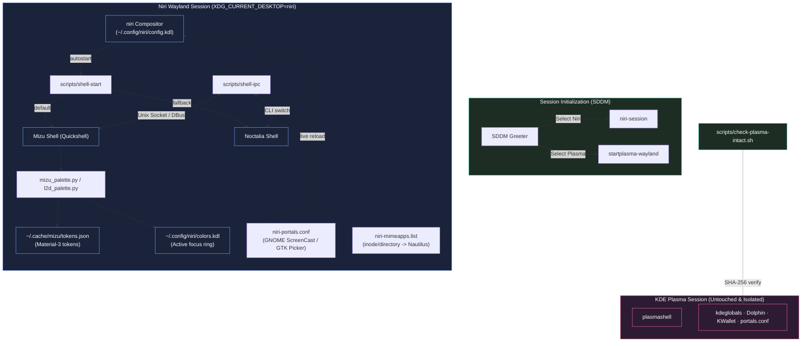
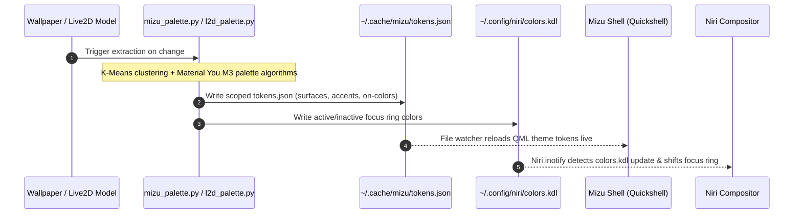

# 🌊 Mizumi Dotfiles — System Specification & Architecture Reference

> **Document Version:** 1.0.0  
> **Target Audience:** Maintainers, core contributors, and automated subagent workflows.  
> **Scope:** Architecture contracts, KDE Plasma zero-leakage invariants, dual-shell lifecycle, dynamic theming pipeline, display pipeline, and verification protocols.

---

## 1. System Overview & Core Philosophy

The **Mizumi Dotfiles** repository manages a scrollable-tiling Wayland session driven by [niri](https://github.com/YaLTeR/niri) on Arch Linux. Its fundamental engineering constraint is:

> **The Zero-Leakage Invariant:**  
> The entire niri environment, including shells, daemons, environment variables, theme generation, and portal configurations, MUST coexist side-by-side with a production KDE Plasma 6 desktop **without modifying, overriding, or leaking into KDE Plasma configuration files**.

Plasma integrity is verified via byte-identical cryptographic hash matching (`scripts/check-plasma-intact.sh compare` must strictly exit `0`).

---

## 2. System Architecture & Component Interactions



### 2.1 Dual-Shell Architecture

1. **Mizu Shell (Primary / Default)**
   - **Engine:** [Quickshell](https://quickshell.outfoxxed.me/) (Qt Quick / QML engine for Wayland).
   - **Features:** 
     - Dynamic Material You / KDE color extraction from active wallpaper.
     - 3D perspective phone projection launcher with fluid physics.
     - Interactive desktop widgets (Da Nang weather, calendar, clock, player card).
     - Media player with synced lyrics widget.
     - Quick Settings Control Center (Wi-Fi, Bluetooth, Audio, Brightness, Live2D tile).
   - **Lifecycle Management:** Managed via `scripts/switch-shell.sh mizu` and `niri/.config/niri/scripts/shell-start`.

2. **Noctalia Shell (Minimal Fallback)**
   - **Role:** Ultra-fast, minimal fallback shell designed for resource-constrained tasks or maintenance.
   - **Configuration:** Scoped under `noctalia/.config/noctalia/`.
   - **Constraint:** Built-in and community templates MUST stay disabled, and `sync_color_scheme = false` to prevent writing to `kdeglobals` or global gsettings.

3. **Live Shell Switching Protocol (`scripts/switch-shell.sh`)**
   - Syntax: `scripts/switch-shell.sh [mizu|noctalia|toggle|status]`
   - Atomically terminates the running shell, updates state in `~/.cache/mizu/current_shell`, and launches the selected target with appropriate environment guards.

---

## 3. KDE Plasma Zero-Leakage & Isolation Specification

To guarantee 100% isolation when running side-by-side on the same machine:

| Domain | Isolation Mechanism | Verification Target |
|---|---|---|
| **Environment Variables** | Scoped strictly to `niri/.config/niri/config.kdl` (`environment { ... }`). Never written to `/etc/environment` or `~/.config/environment.d/`. | `check-plasma-intact.sh snapshot/compare` |
| **Color Schemes** | Dynamic colors write only to `~/.cache/mizu/tokens.json` and `~/.config/niri/colors.kdl`. No writes to `~/.config/kdeglobals`. | Checksum matching on `kdeglobals` |
| **Default File Manager** | Scoped via XDG Desktop MIME specification `~/.config/niri-mimeapps.list` (`inode/directory=org.gnome.Nautilus.desktop`). Leaves Plasma Dolphin untouched. | `mimeapps.list` sha256 |
| **XDG Desktop Portals** | Desktop-specific `niri-portals.conf` configures GNOME portal for `ScreenCast` and `Screenshot`, and GTK portal for `FileChooser`. Plasma uses `kde-portals.conf`. | `portals.conf` sha256 |
| **Secrets & Keyring** | `gnome-keyring` is **strictly prohibited**. `org.freedesktop.secrets` is served exclusively by KWallet for both sessions. | Package manifest audit |

### 3.1 Plasma Integrity Audit Protocol (`scripts/check-plasma-intact.sh`)

- **`snapshot`**: Computes SHA-256 hashes of critical Plasma configuration targets when plasmashell is cleanly stopped.
- **`compare`**: Re-computes SHA-256 hashes and compares against snapshot. Exits `0` on success; exits `1` on any drift.
- **`packages`**: Verifies that `xdg-desktop-portal-kde`, `plasma-desktop`, and `sddm` remain fully installed with zero missing files.
- **`noctalia`**: Verifies that template isolation flags remain enforced.

---

## 4. The Two-Rice Matrix (`main` vs `feat/mizu-l2d`)

The codebase supports two distinct operational modes:

| Feature / Metric | Mizu Lite (`main` branch) | Mizu Full (`feat/mizu-l2d` branch) |
|---|---|---|
| **Live2D Wallpaper Daemon** | Excluded | Integrated (`mizu-l2d` daemon via systemd user unit) |
| **Desktop Background** | Static image wallpaper via Quickshell `WallpaperLayer.qml` | Hybrid: Static image OR interactive Live2D layer (`wlr-layer-shell` background) |
| **Theming Driver** | `mizu_palette.py` (extracts from active picture) | `l2d_palette.py` (extracts from Live2D model textures & skin background) |
| **Quick Panel Live2D Tile** | Disabled | Enabled (single-click toggle for wallpaper host) |
| **Model Browser & Cache** | None | Built-in grid model browser with atomic downloader & quota eviction |
| **Graceful Degradation** | Native default | When `wallpaper.live = false`, zero Live2D processes run; behaves identically to Lite |

---

## 5. Dynamic Theming Engine & Color Generation Protocol

Every color in the desktop shell derives dynamically from the active background:



### 5.1 Dark/Light Synchronization (`sync-theme`)
- Dispatches GTK `color-scheme` via `gsettings`.
- Dispatches KDE colorscheme via `plasma-apply-colorscheme BreezeDark` or `BreezeLight`.
- Dispatches D-Bus activation environments so Qt and GTK applications follow seamlessly.

---

## 6. Display Pipeline & Hybrid Graphics Architecture

- **Primary Display (`eDP-1`):** Laptop screen (1920x1080 @ 144Hz, integer scaling `1.0`).
- **External Display (`HDMI-A-1`):** External monitor (1920x1080 @ 120Hz at `x=1920 y=0`, integer scaling `1.0`).
- **Compositor Rendering:** Bound to Intel iGPU (`/dev/dri/by-path/pci-0000:00:02.0-render`, `renderD129`) for ultra-low power consumption and zero compositor stutter.
- **NVIDIA dGPU Offload:** Dispatched selectively using `prime-run <command>` (utilizing NVIDIA dynamic power management runtime PM).

---

## 7. Input Method Specification (Fcitx5)

- Hotkey: <kbd>Mod</kbd>+<kbd>BackSpace</kbd> dispatches `niri/.config/niri/scripts/fcitx5-cycle`.
- State Machine: Cycles sequentially through:
  $$\text{English (US)} \longrightarrow \text{Vietnamese (Lotus)} \longrightarrow \text{Japanese (Anthy)} \longrightarrow \text{English (US)}$$
- Environment Guards: `GTK_IM_MODULE=`, `QT_IM_MODULE=fcitx`, `XMODIFIERS=@im=fcitx`.

---

## 8. Repository Layout & Component Reference

```
dotfiles/
├── docs/                               # Documentation & specifications
│   ├── adr/                            # Architecture Decision Records
│   ├── screenshots/                    # High-resolution demo screenshots
│   ├── USAGE.md                        # User manual (Vietnamese)
│   └── PERFORMANCE.md                  # Compositor & shell latency benchmarks
├── niri/.config/niri/
│   ├── config.kdl                      # Niri compositor master configuration
│   ├── colors.kdl                      # Generated dynamic accent colors (ignored in git)
│   ├── niri-mimeapps.list              # Session-scoped default applications (Nautilus)
│   ├── scripts/                        # Session automation (shell-start, sync-theme, etc.)
│   └── xdg-desktop-portal/             # Portal routing definitions
├── quickshell/.config/quickshell/mizu/  # Mizu Quickshell implementation
│   ├── assets/                         # Graphic assets and icons
│   ├── modules/mizu/                   # UI modules (bar, widgets, launcher, quickPanel)
│   ├── palette/                        # Palette generators (mizu_palette.py, l2d_palette.py)
│   └── services/                       # Background reactive services (MizuIpc, L2dService)
├── noctalia/.config/noctalia/          # Noctalia fallback shell configuration
├── scripts/
│   ├── check-plasma-intact.sh          # Plasma integrity snapshot and verification suite
│   └── switch-shell.sh                 # Safe shell switcher CLI
├── tests/                              # Automated test suite (Python + Bash)
├── README.md                           # Visual showcase & quickstart guide
└── SPECIFICATION.md                    # This document
```

---

## 9. Quality Assurance & Test Protocol

The repository includes an automated testing suite executable via:

```sh
bash tests/run-all.sh
```

Key test categories:
1. `test_niri_config.py`: Syntax and keybinding collision analysis on `config.kdl`.
2. `test_palette.py`: Color extraction, contrast ratios (WCAG AA), and JSON token schema validity.
3. `test_plasma_integrity.py`: Verifies zero modifications to Plasma files.
4. `test_mizu_l2d.py`: Live2D IPC commands, state persistence, and mirror layout toggles.
5. `test_l2d_cache.py`: Cache eviction, quota constraints, and ledger accuracy.

---

## 10. TTY Installation Runbook & Rollback Specification

### 10.1 Pre-flight Checklist (TTY Virtual Terminal)
1. Terminate graphical session: `loginctl terminate-session <id>`.
2. Enter TTY3: <kbd>Ctrl</kbd>+<kbd>Alt</kbd>+<kbd>F3</kbd>.
3. Take Plasma baseline snapshot:
   ```sh
   bash scripts/check-plasma-intact.sh snapshot
   ```
4. Install packages:
   ```sh
   sudo pacman -S --needed stow noctalia xwayland-satellite xdg-desktop-portal-gnome
   bash scripts/check-plasma-intact.sh packages
   ```
5. Deploy symlinks via GNU Stow:
   ```sh
   stow -v --no-folding -t ~ niri noctalia quickshell
   bash scripts/check-plasma-intact.sh noctalia
   ```
6. Test in Niri session, then verify post-session Plasma intactness:
   ```sh
   bash scripts/check-plasma-intact.sh compare
   ```

### 10.2 Rollback Procedure
```sh
stow -D --no-folding -t ~ quickshell noctalia niri
rm -rf ~/.cache/mizu ~/.local/state/noctalia
```
